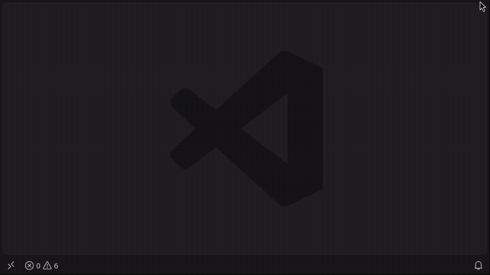
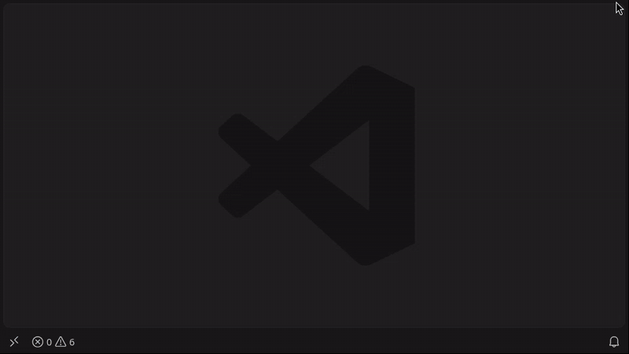
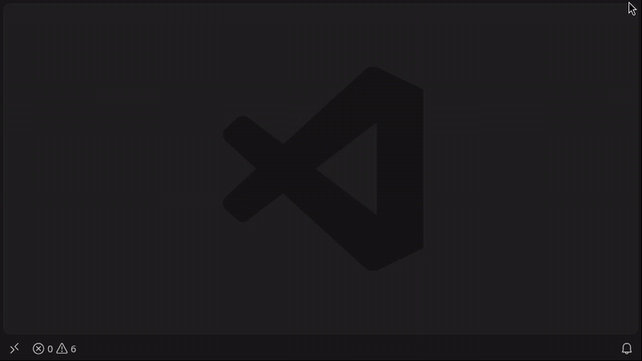

# Demos

Short recordings of each feature. They are scripted, so they stay in step with the extension; see
[demo/COVERAGE.md](../demo/COVERAGE.md) for what is covered and how to re-record them.

The
[full video demo](https://github.com/user-attachments/assets/87cce237-4214-4047-a5c4-b6a4162245d2)
walks through the extension in one take.

## Sort the current file

Run **Keep Sorted: Sort Current File** from the Command Palette to sort every block in the file.

## Sort every file with problems

Run **Keep Sorted: Sort All Files with Problems** to fix files you have not opened, and the Problems
panel empties.

## Options autocomplete and hover

On a `keep-sorted start` line, suggestions list the available options, and hovering an option shows
its documentation.

